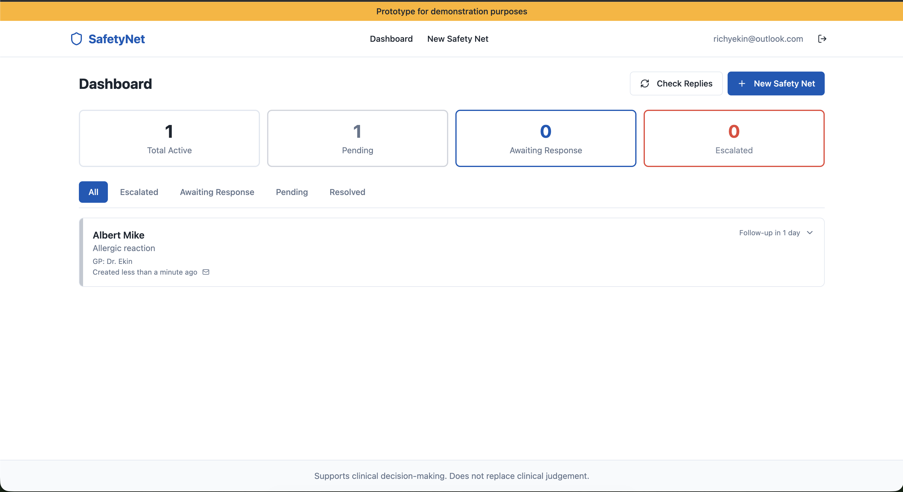

<h1 align="center">SafetyNett</h1>

<p align="center">
  <strong>Patient follow-up for GPs, from check-in to clinician review.</strong>
</p>

SafetyNett brings follow-up requests and patient responses into one dashboard.
Choose a condition, set when to check in and select warning signs to watch for.
Send an email check-in through the configured backend, then review the reply
and any matching warning signs alongside the original follow-up.

**See who is due a check-in, who has not replied and which replies were flagged for review.**

<p align="center">
  <strong>Hackathon finalist · Built in 2.5 hours</strong><br>
  <a href="https://clinicalhackathon.com">OpenClaw Clinical Hackathon</a> ·
  Accurx HQ, London · 28 March 2026
</p>

<p align="center">
  <a href="https://github.com/Ekin-Kahraman/safetynett/actions/workflows/ci.yml"></a>
  <a href="https://www.typescriptlang.org/"></a>
  <a href="https://safetynett.lovable.app"></a>
  <a href="LICENSE"></a>
</p>

<p align="center">
  <a href="https://safetynett.lovable.app">Try the demo</a> ·
  <a href="#how-it-works">How it works</a> ·
  <a href="#quick-start">Run locally</a> ·
  <a href="#verification">Verification</a> ·
  <a href="#team">Team</a>
</p>

*Unvalidated prototype. Use synthetic demonstration data only.*

## How it works

**Create a follow-up → Send a check-in → Record a reply → Flag matches for review**



| Feature | What you can do |
| --- | --- |
| **Plan a follow-up** | Record patient details, condition, GP and optional notes. Choose 24 hours, 48 hours, 72 hours or 7 days. |
| **Choose warning signs** | Select alert phrases from templates across **nine specialties**, or enter a custom condition and warning signs. |
| **Send a check-in** | Send a pending email follow-up through the configured backend. |
| **Track responses** | Filter by status, see escalations first and inspect overdue follow-ups, reply text and timestamped check-in history. |
| **Flag for review** | Match response text against the selected phrases and highlight matches for clinician review. |
| **Explore the workflow** | Use **Simulate Response (Demo)** with “Feeling better”, “Red flags present” or your own text to inspect response handling. |

The dashboard keeps the follow-up plan, communication status and response
together, so a clinician can see what is outstanding and why a record was flagged.
Keyword matching flags text for review; it does not assess whether a patient is safe.

[Open the hosted demo](https://safetynett.lovable.app) and sign in to explore.
The screenshot and hosted demo show the hackathon interface. The maintained
code labels unmatched responses **“No keyword match”** and reports loading and
delivery errors. The hosted demo is a separate deployment; repository changes
do not automatically update its frontend, functions or database.

<details>
<summary>Condition templates: nine specialties</summary>

| Specialty | Example conditions |
| --- | --- |
| Paediatrics | Viral URTI, bronchiolitis, croup, febrile convulsion, meningitis |
| Respiratory | Pneumonia, asthma exacerbation, pulmonary embolism, COPD exacerbation |
| Cardiology | Acute coronary syndrome, heart failure, atrial fibrillation, pericarditis |
| Gastroenterology | Appendicitis, pancreatitis, gastroenteritis, upper GI bleed |
| Neurology | Concussion, migraine, subarachnoid haemorrhage, first seizure |
| ENT | Tonsillitis, peritonsillar abscess, otitis media, epiglottitis |
| Mental Health | Acute suicidal ideation, psychotic episode, acute anxiety |
| Musculoskeletal | Suspected fracture, septic arthritis, cauda equina syndrome |
| Dermatology | Cellulitis, allergic reaction, necrotising fasciitis |

The [template library](src/lib/conditions.ts) was authored with reference to
[NICE Clinical Knowledge Summaries](https://cks.nice.org.uk/) and
[NHS 111](https://111.nhs.uk/), with clinical review by Simon Yip during the
hackathon. These are demonstration templates, not complete, validated or
endorsed clinical pathways.

</details>

<br>

## Engineering

The maintained version makes delivery failures visible and keeps response
history consistent with dashboard status:

- **Checked delivery:** a follow-up is recorded as sent only after the email
  provider accepts it. Rejected delivery and unsupported phone calls stay pending.
- **Consistent records:** status and check-in history are written in one database
  transaction, so a failed write cannot leave them out of sync.
- **Authenticated operations:** backend functions verify the signed-in user and
  use their row-level permissions. Email credentials stay on the server.

[Dashboard](src/pages/Dashboard.tsx) ·
[Follow-up handler](supabase/functions/trigger-followup/handler.ts) ·
[Response handler](supabase/functions/process-response/handler.ts) ·
[Transactional writes](supabase/migrations/20261025120000_atomic_followup_records.sql)

<details>
<summary>Architecture and repository map</summary>

```text
React interface → authenticated Supabase function → user-scoped records
                              │
                   Email provider / keyword match
                              │
                   Transactional status + history
                              │
                          Dashboard
```

React, TypeScript, Tailwind CSS and shadcn/ui provide the interface. Supabase
provides PostgreSQL, authentication and Deno edge functions. OpenMail handles
email from the backend; Lovable Cloud hosts the demonstration.

| Location | Purpose |
| --- | --- |
| `src/pages/`, `src/components/` | Dashboard, forms and status views |
| `src/lib/conditions.ts` | Condition templates and alert phrases |
| `src/integrations/supabase/` | Browser client and database types |
| `supabase/functions/` | Authenticated delivery and response handlers |
| `supabase/migrations/` | Schema, ownership policies and transactional writes |
| `tests/`, `src/test/` | Handler, database and frontend tests |
| `.github/workflows/ci.yml` | Repeatable verification on pushes and pull requests |

</details>

<br>

## Quick start

Use **Node.js 20** and npm. From a clean checkout:

```sh
npm ci
cp .env.example .env
# Set the public Supabase URL and publishable/anon key in .env
npm run dev
```

The app requires a Supabase project with the committed schema and functions.
Use a disposable development project and synthetic records. Browser configuration
contains only the public Supabase URL/key; keep OpenMail credentials in backend
secrets, never in a `VITE_` variable.

<details>
<summary>Backend setup and endpoint contracts</summary>

Apply the migrations in `supabase/migrations/`, including the transaction migration,
then deploy both functions using the [Supabase CLI](https://supabase.com/docs/guides/local-development/cli/getting-started).
Set `OPENMAIL_API_KEY` and `OPENMAIL_INBOX_ID` as function secrets; see
[the backend environment example](supabase/functions/.env.example).
Supabase supplies `SUPABASE_URL` and `SUPABASE_ANON_KEY` at runtime.

Keep JWT verification enabled. Both functions require a signed-in user's bearer
token and operate within that user's row-level permissions. They are not
anonymous patient-response webhooks or global administrator jobs.

| Endpoint | Request | Behaviour |
| --- | --- | --- |
| `trigger-followup` | `POST {"safety_net_id":"<UUID>"}` | Attempts one pending record belonging to the caller. |
| `trigger-followup` | `POST {}` | Attempts up to 100 of the caller's pending records whose follow-up time has passed. |
| `process-response` | `POST {"safety_net_id":"<UUID>","response_text":"..."}` | Saves the response and keyword result together; reports notification acceptance/failure separately. |
| `process-response` | Add `"simulation":true` | Saves a demonstration response without sending a notification. The maintained UI simulation uses this mode. |

Email requests use the provider's inbox endpoint and a stable idempotency key.
Provider acceptance does not confirm recipient delivery. Email and the database
cannot share one transaction: if recording fails after provider acceptance, review
the failure before retrying. The provider documents a
[24-hour idempotency window](https://docs.openmail.sh/best-practices/idempotency).

Scheduling and inbound email routing require separate configuration. Automated
phone calls are not implemented and are disabled in the maintained creation form.
Each function pins its Supabase dependency in `deno.json`; CI checks the Deno
entry points against dependencies installed from `package-lock.json`.

[Authentication](https://supabase.com/docs/guides/functions/auth) ·
[Function dependencies](https://supabase.com/docs/guides/functions/dependencies) ·
[OpenMail](https://openmail.sh/)

</details>

<br>

## Verification

```sh
npm run lint
npm run typecheck
npm test
npm run build
```

Locked dependencies and automated checks cover the interface, backend handlers
and database transactions. Tests use synthetic records, mocked delivery and an
embedded PostgreSQL runtime ([PGlite](https://pglite.dev/)); no Supabase or
OpenMail credentials are needed and no external emails are sent.

<details>
<summary>Test coverage and measured frontend improvement</summary>

| Layer | Checks |
| --- | --- |
| Templates | Specialty coverage, unique condition names and non-empty definitions |
| Request handlers | Authentication, owner-scoped queries, invalid inputs, provider rejection, recording failures and simulation without email |
| Database | Row ownership, atomic rollback, repeat delivery recording and response-history preservation |
| Build | Frontend/backend TypeScript, Deno entry points, lint and production compilation |

Lazy-loaded pages keep dashboard and creation-form code out of the initial
sign-in load. In a local Vite 5.4.19 production build (Node 25.9.0), the main
JavaScript chunk fell from **605.54 kB to 476.07 kB**, **21% smaller** before
compression. This measures the main chunk, not total app size or page-load latency.

</details>

## Scope

This is a software prototype, not a validated clinical device or clinical AI
system. Keyword matching can miss concerns, misread negation and produce false
alerts. **“No keyword match” is not a clinical assessment**; the legacy database
value is `resolved`.

Software checks and hackathon clinical review do not establish clinical safety
or accuracy. There is no outcome study, NHS endorsement or evidence of reduced
deterioration or clinician workload. Use in care would require formal clinical,
privacy, access, delivery-reliability and governance assessment.

<details>
<summary>Future directions</summary>

Model-assisted response interpretation with human review, voice and language
options, clinical-record integration and auditable review decisions remain
proposed work. A second model alone would not establish safety. Voice calls and
transcription are not implemented in this repository.

</details>

## Team

Co-built by [Ekin Kahraman](https://github.com/Ekin-Kahraman) and
[Simon Yip](https://github.com/SimonYip22), as part of a five-person team at the
OpenClaw Clinical Hackathon. The repository includes subsequent engineering work
on delivery handling, response consistency and verification.

[MIT licence](LICENSE) · [Citation metadata](CITATION.cff) · [Contributing](CONTRIBUTING.md)
