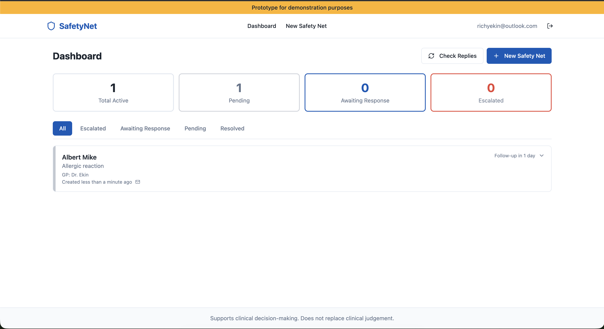

<h1 align="center">SafetyNett</h1>

<p align="center">
  <strong>Hackathon finalist prototype.<br>
  Follow-up responses, shared tracking and clinician review alerts.</strong>
</p>

<p align="center">
  Co-built in <strong>2.5 hours</strong> at the
  <a href="https://clinicalhackathon.com">OpenClaw Clinical Hackathon</a>,
  Accurx HQ, London · 28 March 2026.
</p>

<p align="center">
  <a href="https://github.com/Ekin-Kahraman/safetynett/actions/workflows/ci.yml"></a>
  <a href="https://www.typescriptlang.org/"></a>
  <a href="https://safetynett.lovable.app"></a>
  <a href="LICENSE"></a>
</p>

<table>
  <tr>
    <td valign="top">Product</td>
    <td><strong>One dashboard for follow-up records and responses</strong><br>
      Create a follow-up, track its status and surface responses that match configured alert phrases.</td>
  </tr>
  <tr>
    <td valign="top">Delivery</td>
    <td><strong>Working prototype built within a 2.5-hour hackathon</strong><br>
      React/TypeScript interface, Supabase backend and demonstration templates across nine clinical specialties.</td>
  </tr>
  <tr>
    <td valign="top">Engineering</td>
    <td><strong>Checked delivery states and consistent response records</strong><br>
      Authenticated backend operations, server-side email credentials and transactional status/history updates, covered by automated failure-path tests.</td>
  </tr>
</table>

<p align="center">
  <a href="https://safetynett.lovable.app">Demo</a> ·
  <a href="#what-this-project-adds">Contribution</a> ·
  <a href="#quick-start">Run locally</a> ·
  <a href="#verification">Verification</a> ·
  <a href="#team">Team</a>
</p>

*Unvalidated software prototype. Use synthetic demonstration data only.*

## See the workflow

**Input:** a follow-up record, selected alert phrases and a submitted response.<br>
**Output:** a shared status view and a keyword-triggered request for review.



The screenshot shows the hackathon interface. The maintained version labels a
response without a keyword match explicitly and reports loading/delivery errors.
The hosted demo is a separate deployment; changes to this repository do not
by themselves update its backend or database.

## What this project adds

The team explored a practical product question: how can follow-up requests and
responses be visible together, rather than tracked separately?

I co-built the prototype with [Simon Yip](https://github.com/SimonYip22) as part
of a five-person team. The repository demonstrates the product workflow and
subsequent engineering work to make its behaviour more dependable and inspectable.

| Area | Implementation | Useful output |
| --- | --- | --- |
| **Follow-up tracking** | Create records, select templates and filter by status. | A dashboard of pending contacts and recorded responses. |
| **Response review** | Match response text against configured alert phrases. | A review flag and saved response history; no clinical judgement is inferred. |
| **Delivery handling** | Send through an authenticated backend; record provider acceptance only after success. | Failed delivery and unimplemented phone calls remain pending. |
| **Data integrity** | Commit status and check-in changes in one database transaction. | A failed write cannot leave those two records out of sync. |
| **Reproducibility** | Locked dependencies, typed handlers and automated UI/backend/database tests. | A repeatable way to check behaviour without sending email or using patient data. |

[Frontend](src/pages/Dashboard.tsx) · [Follow-up handler](supabase/functions/trigger-followup/handler.ts) ·
[Response handler](supabase/functions/process-response/handler.ts) ·
[Transactional writes](supabase/migrations/20261025120000_atomic_followup_records.sql)

## Quick start

Use **Node.js 20** and npm. From a clean checkout:

```sh
npm ci
cp .env.example .env
# Set the public Supabase URL and publishable/anon key in .env
npm run dev
```

The interface requires a Supabase project with the committed schema and functions.
Use a disposable development project and synthetic records. Browser configuration
contains only the public Supabase URL/key; **OpenMail credentials stay in backend
secrets**. Never put them in a `VITE_` variable.

<details>
<summary>Backend setup and endpoint contracts</summary>

Apply the migrations in `supabase/migrations/`, including the transaction migration,
then deploy both functions using the [Supabase CLI](https://supabase.com/docs/guides/local-development/cli/getting-started).
Configure `OPENMAIL_API_KEY` and `OPENMAIL_INBOX_ID` as function secrets; the example
is in [supabase/functions/.env.example](supabase/functions/.env.example).
Supabase supplies `SUPABASE_URL` and `SUPABASE_ANON_KEY` to the function runtime.

Each function has a `deno.json` pinning its Supabase dependency. CI checks the
Deno entry points against the dependencies installed from `package-lock.json`.
Keep JWT verification enabled. Both endpoints require a signed-in user's bearer
token, verify it, and operate through that user's row-level security permissions.
They are not anonymous patient-response webhooks or global administrator jobs.

| Endpoint | Request | Behaviour |
| --- | --- | --- |
| `trigger-followup` | `POST {"safety_net_id":"<UUID>"}` | Attempts one pending record belonging to the caller. |
| `trigger-followup` | `POST {}` | Attempts up to 100 of the caller's pending records whose follow-up time has passed. |
| `process-response` | `POST {"safety_net_id":"<UUID>","response_text":"..."}` | Saves the response and keyword result together; reports notification acceptance/failure separately. |
| `process-response` | Add `"simulation":true` | Saves a demonstration response without sending a notification. The UI simulation uses this mode. |

Email requests use the provider's inbox endpoint and a stable idempotency key.
Provider acceptance does not confirm delivery to the recipient. Email and the
database cannot share one transaction: if recording fails after provider acceptance,
review the failure before retrying. The provider's idempotency window is finite.

Scheduling and inbound email routing need separate configuration. Automated phone
calls are not implemented and are disabled in the creation form.

[Supabase authentication](https://supabase.com/docs/guides/functions/auth) ·
[Function dependencies](https://supabase.com/docs/guides/functions/dependencies) ·
[OpenMail provider](https://openmail.sh/)

</details>

## Verification

```sh
npm run lint
npm run typecheck
npm test
npm run build
```

The tests use synthetic records, mocked network responses and an embedded
PostgreSQL runtime ([PGlite](https://pglite.dev/)). They make no external email
requests and need no Supabase or OpenMail credentials.

| Layer | Checks |
| --- | --- |
| **Templates** | Specialty coverage, unique condition names and non-empty definitions. |
| **Request handlers** | Authentication, owner-scoped queries, invalid inputs, provider rejection, recording failures and simulation without email. |
| **Database** | Row-level ownership, atomic rollback, repeat delivery recording and preservation of response history. |
| **Build** | TypeScript frontend and backend checks, Deno entry-point checks, lint and production compilation. |

Pages are lazy-loaded so the sign-in screen does not load the creation form and
dashboard code up front. In a local Vite 5.4.19 production build (Node 25.9.0),
the main JavaScript chunk fell from **605.54 kB to 476.07 kB** across this update
(**21% smaller**, before compression). This measures the main chunk, not total
application size or page-load latency.

Template tests check software structure, not medical correctness. None of these
checks establishes clinical safety, clinical accuracy or reliable real-world delivery.

## Architecture

```text
React interface → authenticated Supabase function → caller-scoped records
                              │
                   Email provider / keyword match
                              │
                   Transactional status + history
                              │
                       Shared dashboard
```

<details>
<summary>Technology and repository structure</summary>

- **Interface:** React, TypeScript, Tailwind CSS and shadcn/ui.
- **Backend:** Supabase PostgreSQL, authentication and Deno edge functions.
- **Email:** OpenMail, called only from the backend.
- **Hosted demonstration:** Lovable Cloud.

| Location | Purpose |
| --- | --- |
| `src/pages/`, `src/components/` | Dashboard, forms and status views. |
| `src/lib/conditions.ts` | Demonstration condition and alert-phrase templates. |
| `src/integrations/supabase/` | Browser client and database types. |
| `supabase/functions/` | Authenticated delivery and response handlers. |
| `supabase/migrations/` | Schema, ownership policies and transactional writes. |
| `tests/`, `src/test/` | Handler, database and frontend/template tests. |
| `.github/workflows/ci.yml` | Repeatable verification on pushes and pull requests. |

</details>

<details>
<summary>Condition templates — nine specialties</summary>

The team used [NICE Clinical Knowledge Summaries](https://cks.nice.org.uk/) and
[NHS 111](https://111.nhs.uk/) materials as references. These are demonstration
content, not complete, validated or endorsed clinical pathways.

| Specialty | Example conditions |
| --- | --- |
| Paediatrics | Viral URTI, bronchiolitis, croup, febrile convulsion, meningitis |
| Respiratory | Pneumonia, asthma exacerbation, pulmonary embolism, COPD exacerbation |
| Cardiology | Acute coronary syndrome, heart failure, atrial fibrillation, pericarditis |
| Gastroenterology | Appendicitis, pancreatitis, gastroenteritis, upper GI bleed |
| Neurology | Concussion, migraine, subarachnoid haemorrhage, first seizure |
| ENT | Tonsillitis, peritonsillar abscess, otitis media, epistaxis |
| Mental Health | Acute suicidal ideation, psychotic episode, acute anxiety |
| Musculoskeletal | Suspected fracture, septic arthritis, cauda equina syndrome |
| Dermatology | Cellulitis, allergic reaction, necrotising fasciitis |

See the [complete template library](src/lib/conditions.ts). Clinical content needs
formal review before any use in care.

</details>

## Limitations and future work

Keyword matching cannot reliably understand context or negation and can miss
concerns or produce false alerts. A match requires review; a missing match does
not mean a patient is safe. The legacy database value `resolved` means only that
no keyword matched; the interface displays **“No keyword match.”**

This is not a deployed clinical device or a validated clinical AI system. There
is no outcome study, NHS endorsement or evidence that it reduces missed
deterioration or clinician workload. Real-world use would require formal clinical,
privacy, access, delivery-reliability and governance assessment.

<details>
<summary>Proposed directions, not implemented capabilities</summary>

- Model-assisted response interpretation with human review and explicit failure testing.
- Voice and language options explored with users.
- Clinical-record integration subject to permissions and formal review.
- Auditable communication/review decisions and configurable alert phrases.

A second model alone would not establish safety. Voice calls and transcription
are not implemented in this repository.

</details>

## Team

Co-built by [Ekin Kahraman](https://github.com/Ekin-Kahraman) and
[Simon Yip](https://github.com/SimonYip22), as part of a five-person team at the
OpenClaw Clinical Hackathon.

Clinical template content was authored with reference to NICE CKS and NHS 111
pathway documentation, with clinical review by Simon Yip. That hackathon review
is distinct from validation for clinical deployment.

## Licence

[MIT](LICENSE) · [Citation metadata](CITATION.cff) · [Contributing](CONTRIBUTING.md)
