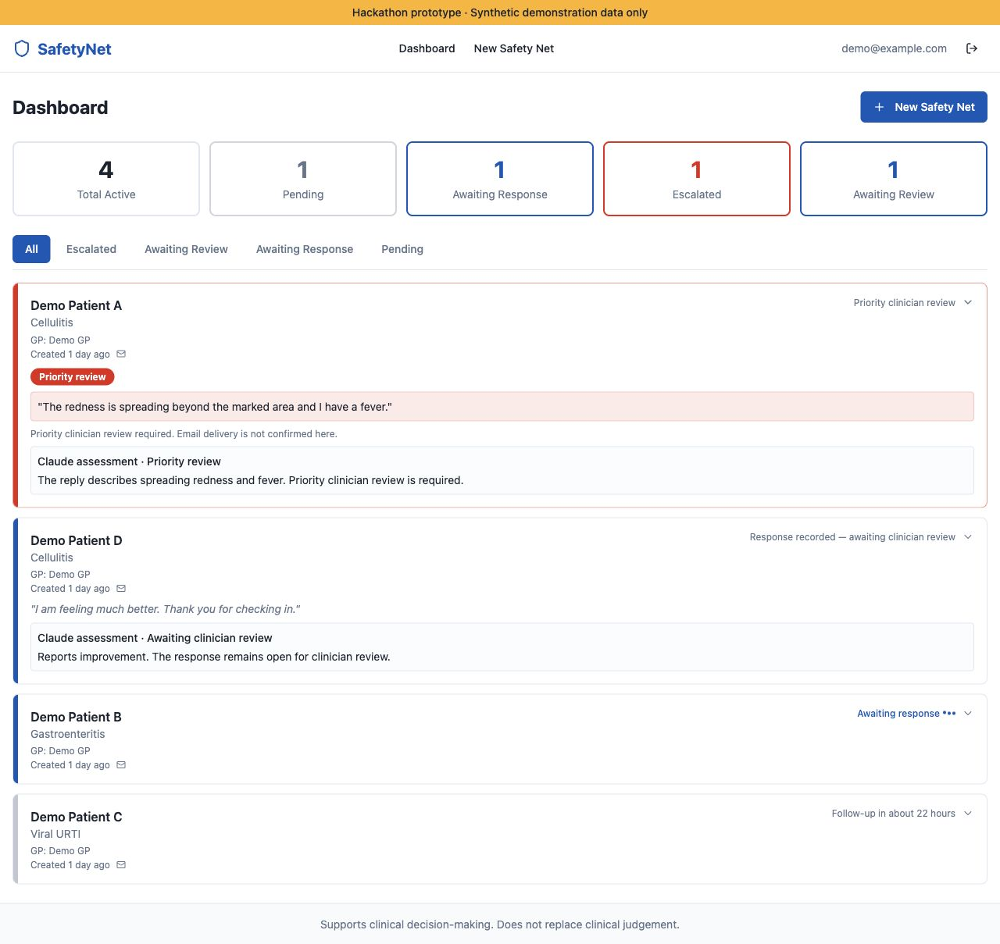
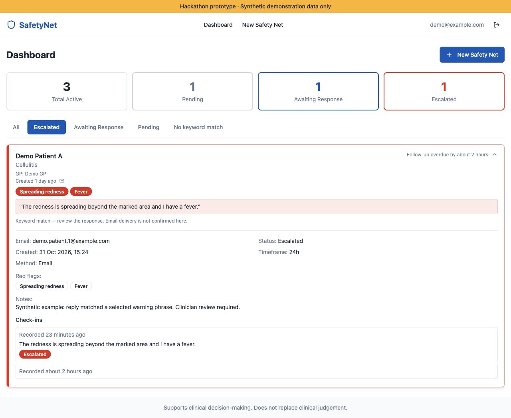

<h1 align="center">SafetyNett</h1>

<p align="center">
  <strong>GP follow-ups, patient replies and review flags in one view.</strong>
</p>

SafetyNett helps GPs follow up after a consultation. Set a check-in time,
select condition-specific warning signs and send an email. Replies are recorded
and checked for matching phrases, ready for clinician review alongside the
original follow-up.

<p align="center">
  <a href="https://github.com/Ekin-Kahraman/safetynett/actions/workflows/ci.yml"></a>
  <a href="https://safetynett.lovable.app"></a>
  <a href="LICENSE"></a>
</p>

<p align="center">
  <a href="https://safetynett.lovable.app">Try the demo</a> ·
  <a href="#try-the-workflow">Walkthrough</a> ·
  <a href="#run-locally">Run locally</a> ·
  <a href="#scope">Scope</a> ·
  <a href="#team">Team</a>
</p>

- **Nine specialties**, with selectable warning signs and custom conditions.
- **Four follow-up intervals:** 24 hours, 48 hours, 72 hours or 7 days.
- **Hackathon finalist**, co-built in **2.5 hours** at the [OpenClaw Clinical Hackathon](https://clinicalhackathon.com).

*Synthetic demonstration data only. Unvalidated prototype.*

## See the workflow

**Plan a follow-up → Send a check-in → Record a reply → Review flagged responses**

[](https://safetynett.lovable.app)

*Maintained interface with synthetic records. The hosted hackathon demo may differ.*

## Try the workflow

[Open the hosted demo](https://safetynett.lovable.app), sign in and choose
**New Safety Net** to explore condition templates and follow-up times.

For the complete workflow in the maintained app:

1. **Plan:** create a synthetic follow-up, choose a condition and select its warning phrases.
2. **Simulate:** expand a pending or awaiting-response card and choose **Simulate Response (Demo)**. Submit text containing a selected warning phrase. No notification is sent.
3. **Review:** the record moves to **Escalated**. Open it to read the reply, selected warning signs and timestamped check-in history. Unmatched replies appear under **No keyword match**.

<details>
<summary>See a flagged reply and its check-in history</summary>



</details>

<details>
<summary>Templates and follow-up options</summary>

Record patient details, the responsible GP and optional notes. Choose a template
and untick warning signs that do not apply, or enter a custom condition and
warning phrases. Dashboard filters show pending contacts, unanswered check-ins,
escalated replies and responses without a keyword match; escalations appear first.

| Specialty | Example conditions |
| --- | --- |
| Paediatrics | Viral URTI, bronchiolitis, croup, febrile convulsion, meningitis |
| Respiratory | Pneumonia, asthma exacerbation, pulmonary embolism, COPD exacerbation |
| Cardiology | Acute coronary syndrome, heart failure, atrial fibrillation, pericarditis |
| Gastroenterology | Appendicitis, pancreatitis, gastroenteritis, upper GI bleed |
| Neurology | Concussion, migraine, subarachnoid haemorrhage, first seizure |
| ENT | Tonsillitis, peritonsillar abscess, otitis media, epiglottitis |
| Mental Health | Acute suicidal ideation, psychotic episode, acute anxiety |
| Musculoskeletal | Suspected fracture, septic arthritis, cauda equina syndrome |
| Dermatology | Cellulitis, allergic reaction, necrotising fasciitis |

The [template library](src/lib/conditions.ts) was authored with reference to
[NICE Clinical Knowledge Summaries](https://cks.nice.org.uk/) and
[NHS 111](https://111.nhs.uk/), with clinical review by Simon Yip during the
hackathon. These are demonstration templates, not complete, validated or
endorsed clinical pathways.

</details>

<br>

## Run locally

Use **Node.js 20** and npm, with a disposable Supabase project and synthetic data:

```sh
npm ci
cp .env.example .env
# Set the public Supabase URL and publishable/anon key in .env
npm run dev
```

Apply the committed schema and functions using the setup below. Keep OpenMail
credentials in backend secrets, never in a browser-facing `VITE_` variable.

<details>
<summary>Backend setup and endpoint contracts</summary>

Apply the migrations in `supabase/migrations/`, including the transaction migration,
then deploy both functions using the [Supabase CLI](https://supabase.com/docs/guides/local-development/cli/getting-started).
Set `OPENMAIL_API_KEY` and `OPENMAIL_INBOX_ID` as function secrets; see
[the backend environment example](supabase/functions/.env.example).
Supabase supplies `SUPABASE_URL` and `SUPABASE_ANON_KEY` at runtime.

Keep JWT verification enabled. Both functions require a signed-in user's bearer
token and operate within that user's row-level permissions. They are not
anonymous patient-response webhooks or global administrator jobs.

| Endpoint | Request | Behaviour |
| --- | --- | --- |
| `trigger-followup` | `POST {"safety_net_id":"<UUID>"}` | Attempts one pending record belonging to the caller. |
| `trigger-followup` | `POST {}` | Attempts up to 100 of the caller's pending records whose follow-up time has passed. |
| `process-response` | `POST {"safety_net_id":"<UUID>","response_text":"..."}` | Saves the response and keyword result together; reports notification acceptance/failure separately. |
| `process-response` | Add `"simulation":true` | Saves a demonstration response without sending a notification. The maintained UI simulation uses this mode. |

Email requests use the provider's inbox endpoint and a stable idempotency key.
Provider acceptance does not confirm recipient delivery. Email and the database
cannot share one transaction: if recording fails after provider acceptance, review
the failure before retrying. The provider documents a
[24-hour idempotency window](https://docs.openmail.sh/best-practices/idempotency).

Scheduling and inbound email routing require separate configuration. Automated
phone calls are not implemented and are disabled in the maintained creation form.
Each function pins its Supabase dependency in `deno.json`; CI checks the Deno
entry points against dependencies installed from `package-lock.json`.

[Authentication](https://supabase.com/docs/guides/functions/auth) ·
[Function dependencies](https://supabase.com/docs/guides/functions/dependencies) ·
[OpenMail](https://openmail.sh/)

</details>

<details>
<summary>Engineering and verification</summary>

The maintained version makes delivery failures visible and keeps response
history consistent with dashboard status:

- **Checked delivery:** a follow-up is recorded as sent only after the email
  provider accepts it. Rejected delivery and unsupported phone calls stay pending.
- **Consistent records:** status and check-in history are written in one database
  transaction, so a failed write cannot leave them out of sync.
- **Authenticated operations:** backend functions verify the signed-in user and
  use their row-level permissions. Email credentials stay on the server.

[Dashboard](src/pages/Dashboard.tsx) ·
[Follow-up handler](supabase/functions/trigger-followup/handler.ts) ·
[Response handler](supabase/functions/process-response/handler.ts) ·
[Transactional writes](supabase/migrations/20261025120000_atomic_followup_records.sql)

```sh
npm run lint
npm run typecheck
npm test
npm run build
```

Tests use synthetic records, mocked delivery and embedded PostgreSQL
([PGlite](https://pglite.dev/)). No external emails are sent or Supabase/OpenMail
credentials required. Dependencies are locked for repeatable checks.

| Layer | Checks |
| --- | --- |
| Templates | Specialty coverage, unique condition names and non-empty definitions |
| Request handlers | Authentication, owner-scoped queries, invalid inputs, provider rejection, recording failures and simulation without email |
| Database | Row ownership, atomic rollback, repeat delivery recording and response-history preservation |
| Build | Frontend/backend TypeScript, Deno entry points, lint and production compilation |

Lazy-loaded pages keep dashboard and creation-form code out of the initial
sign-in load. In a local Vite 5.4.19 production build (Node 25.9.0), the main
JavaScript chunk fell from **605.54 kB to 476.07 kB**, **21% smaller** before
compression. This measures the main chunk, not total app size or page-load latency.

</details>

<details>
<summary>Architecture and repository map</summary>

```text
React interface → authenticated Supabase function → user-scoped records
                              │
                   Email provider / keyword match
                              │
                   Transactional status + history
                              │
                          Dashboard
```

React, TypeScript, Tailwind CSS and shadcn/ui provide the interface. Supabase
provides PostgreSQL, authentication and Deno edge functions. OpenMail handles
email from the backend; Lovable Cloud hosts the demonstration.

| Location | Purpose |
| --- | --- |
| `src/pages/`, `src/components/` | Dashboard, forms and status views |
| `src/lib/conditions.ts` | Condition templates and alert phrases |
| `src/integrations/supabase/` | Browser client and database types |
| `supabase/functions/` | Authenticated delivery and response handlers |
| `supabase/migrations/` | Schema, ownership policies and transactional writes |
| `tests/`, `src/test/` | Handler, database and frontend tests |
| `.github/workflows/ci.yml` | Repeatable verification on pushes and pull requests |

</details>

<details>
<summary>Hosted demo and screenshot notes</summary>

The hosted demo is a separate hackathon deployment. Repository changes do not
automatically update its frontend, functions or database. Its labels and controls
may differ from the maintained code, which explicitly labels unmatched replies
**“No keyword match”** and reports loading and delivery errors.

Both screenshots were captured from the maintained interface with local synthetic
fixtures: Demo Patients A–D, a demo GP and `example.com` email addresses. No live
records were created and no emails sent. They illustrate interface states, not
clinical validation or confirmed delivery.

</details>

## Scope

Keyword matching can miss concerns, misread negation and produce false alerts.
**No keyword match does not mean a patient is safe.** This is an unvalidated
prototype, with no clinical outcome study, NHS endorsement or proven reduction
in deterioration or clinician workload.

<details>
<summary>Clinical scope and future work</summary>

Software checks and hackathon clinical review do not establish clinical safety
or accuracy. Use in care would require formal clinical, privacy, access,
delivery-reliability and governance assessment. The legacy database value
`resolved` means only that no keyword matched.

Model-assisted response interpretation with human review, voice and language
options, clinical-record integration and auditable review decisions remain
proposed work. A second model alone would not establish safety. Voice calls and
transcription are not implemented in this repository.

</details>

## Team

Co-built by [Ekin Kahraman](https://github.com/Ekin-Kahraman) and
[Simon Yip](https://github.com/SimonYip22), as part of a five-person team at the
OpenClaw Clinical Hackathon, Accurx HQ, London, **28 March 2026**. Subsequent
engineering work covers delivery handling, response consistency and verification.

[MIT licence](LICENSE) · [Citation metadata](CITATION.cff) · [Contributing](CONTRIBUTING.md)
