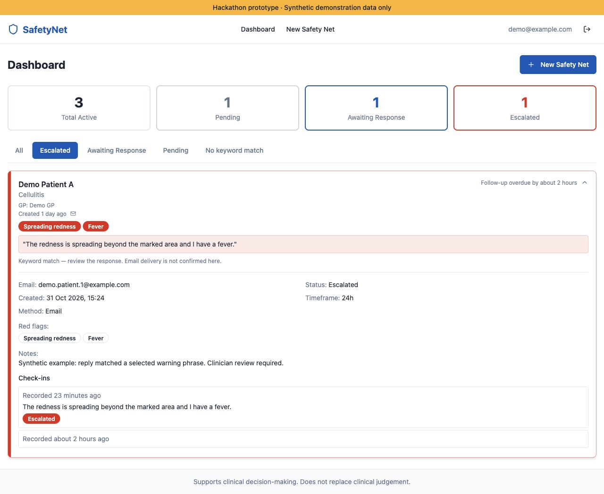

# Demo guide and scope

[SafetyNett](../README.md) · [Setup](setup.md) · [Engineering](engineering.md)

## NHS workflow and intended value

[NHS England's practice-improvement guidance](https://www.england.nhs.uk/long-read/how-to-improve-care-related-processes-in-general-practice/)
identifies administrative burden as a pressure on general practice and describes
integration, automation and asynchronous patient communication as ways to improve
care-related processes. SafetyNett targets the follow-up communication tasks
between an appointment and the GP's next review.

The intended value chain is **fewer manual contact and summary tasks → a smaller
follow-up administration backlog → quicker review handoffs → more clinician time
for care**. The backlog target is outstanding administrative work; patient replies
still require clinician review. Backlog reduction, review speed and released
capacity have not been measured in a practice deployment.

## Try the workflow

[Explore the hosted interface](https://safetynett.lovable.app), sign in and choose
**New Safety Net** to explore condition templates and follow-up times.

To exercise the Claude integration in the maintained app, [configure the backend](setup.md):

1. **Plan:** create a synthetic follow-up, choose a condition, select its concerns and set a check-in time.
2. **Assess:** expand a pending or awaiting-response card and choose **Simulate Response (Demo)**. Submit a synthetic reply; the configured Claude API assesses it without sending a notification email.
3. **Review:** inspect the summary, supporting quotes, model, prompt version and history. Responses remain **Escalated** or **Awaiting Review**.

## Templates and follow-up options

Record patient details, the responsible GP and optional notes. Choose a template
and untick warning signs that do not apply, or enter a custom condition and
concerns. Templates span nine specialties; follow-up intervals are 24 hours,
48 hours, 72 hours or 7 days. Dashboard filters show pending contacts, unanswered
check-ins, priority replies and responses awaiting clinician review; escalations appear first.

| Specialty | Example conditions |
| --- | --- |
| Paediatrics | Viral URTI, bronchiolitis, croup, febrile convulsion, meningitis |
| Respiratory | Pneumonia, asthma exacerbation, pulmonary embolism, COPD exacerbation |
| Cardiology | Acute coronary syndrome, heart failure, atrial fibrillation, pericarditis |
| Gastroenterology | Appendicitis, pancreatitis, gastroenteritis, upper GI bleed |
| Neurology | Concussion, migraine, subarachnoid haemorrhage, first seizure |
| ENT | Tonsillitis, peritonsillar abscess, otitis media, epiglottitis |
| Mental Health | Acute suicidal ideation, psychotic episode, acute anxiety |
| Musculoskeletal | Suspected fracture, septic arthritis, cauda equina syndrome |
| Dermatology | Cellulitis, allergic reaction, necrotising fasciitis |

The [template library](../src/lib/conditions.ts) was authored with reference to
[NICE Clinical Knowledge Summaries](https://cks.nice.org.uk/) and
[NHS 111](https://111.nhs.uk/), with clinical review by Simon Yip during the
hackathon. These are demonstration templates, not complete, validated or
endorsed clinical pathways.

## Deployment status and screenshot provenance

The hosted UI is a separate hackathon deployment. Its OpenMail connection needs
reconfiguration, and this branch's Claude changes await deployment. For the
maintained workflow, deploy the migration, functions, frontend and secrets
together, with scheduling and inbound routing configured.

Both screenshots were captured from the maintained interface with local synthetic
fixtures and mocked Claude outputs: Demo Patients A–D, a demo GP and `example.com`
email addresses. No live records were created, model requests made or emails sent.
They illustrate interface states, not clinical validation or confirmed delivery.

## Clinical scope and future work

An unvalidated clinical prototype for synthetic demonstration data. Claude supports clinician review; it does not diagnose or automatically close follow-ups.

Software checks and hackathon clinical review do not establish clinical safety
or accuracy. Use in care would require formal clinical, privacy, access,
delivery-reliability and governance assessment. The legacy database value
`resolved` is migrated to `review_required`; existing response history is preserved.

Voice and language options, clinical-record integration and clinician completion
controls remain proposed work. Voice calls and transcription are not implemented
in this repository.
